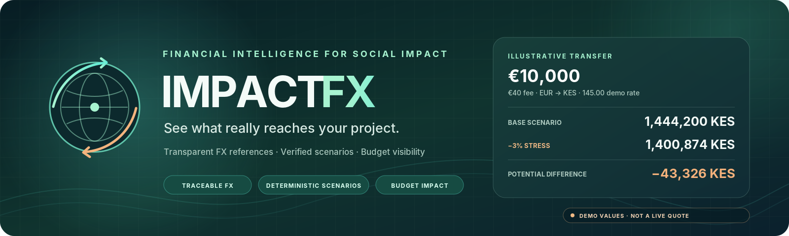

<p align="center">
  
</p>

<h1 align="center">Impact FX</h1>
<p align="center"><strong>Simulación transparente del impacto cambiario en transferencias para proyectos sociales</strong></p>
<p align="center">Agente de IA (MVP) que estima cuánto recibe realmente un socio local, compara escenarios de tipo de cambio y comunica el impacto con trazabilidad, supuestos explícitos y límites claros.</p>

<p align="center">
  <a href="https://github.com/juandelaf1/impact-fx/actions/workflows/ci.yml"></a>
  <a href="https://github.com/juandelaf1/impact-fx/pull/34"></a>
  
  
  
  
  
  
  
  <a href="LICENSE"></a>
  
  
</p>

---

## Visión general

**Impact FX** es un MVP desarrollado para el reto **Ebury + Fundación Somos F5 (Grupo 1)**. Su objetivo es ayudar a ONG y equipos de proyectos sociales a **anticipar el importe neto recibido en moneda local** ante variaciones de tipo de cambio y comisiones, reduciendo incertidumbre en la planificación y comunicación con socios locales.

- **Producto:** simulación clara (escenario base vs estrés), diferencia potencial, supuestos, procedencia de tasa y (cuando aplica) impacto presupuestario demo.
- **Técnico:** agente LLM con *function/tool calling*, verificación determinista, contratos trazables, fallback honesto y ejecución reproducible.
- **Alcance MVP:** corredor **EUR → KES (Kenia)**, 2 escenarios, 2 tools principales, sin ejecución de pagos ni asesoría financiera vinculante.

## Propuesta de valor

| Para quién | Problema | Qué aporta Impact FX |
|---|---|---|
| ONG / gestores de proyectos | El importe recibido puede variar por FX y comisiones, afectando actividades y presupuesto | Estimación rápida y explicable del monto recibido y la diferencia bajo estrés |
| Socios locales / coordinación | Falta de visibilidad compartida sobre supuestos y riesgos cambiarios | Respuesta integrada con cifras, supuestos, fuente/fecha y límites |
| Equipos técnicos/demo | Necesidad de un MVP fiable y auditable en poco tiempo | Flujo determinista verificable, metadatos de ejecución y modos de degradación/fallback transparentes |

## Caso demo (golden case B1)

**Entrada:** 10.000 EUR → Kenia (KES), comisión 40 EUR, tasa ref. 145 KES/EUR (demo/ficticia), variación −3%  
**Resultado esperado:**
- **Base:** 1.444.200 KES
- **Estrés (−3%):** 1.400.874 KES
- **Diferencia:** 43.326 KES
- **Impacto presupuestario demo (KE-HEALTH-001, sintético):** cobertura base 100%, estrés 97%, brecha 43.326 KES

> Los valores se validan contra `data/processed/demo_scenarios.json` y el motor determinista.

## Arquitectura y flujo

```text
Usuario (Streamlit UI)
   │  POST /api/chat
   ▼
FastAPI (validación, CORS, contrato de errores)
   ▼
Orquestador del agente (LLM + tool-calling + guardrails)
   ├─ get_fx_reference (tasa/fuente/fecha/is_mock)
   ├─ calculate_transfer_scenarios (cálculo determinista)
   └─ verificación + metadatos + (budget_impact demo)
   ▼
Respuesta integrada (reply + agent.* trazable)
   │
   ├─ llm_tools (verificado)
   ├─ degradado (sin verificación completa, sin inventar escenarios)
   └─ deterministic_fallback (sin LLM/tools simulados, fixtures demo)
```

**Principios de diseño:** determinismo donde importa, trazabilidad contractual, honestidad en modos degradados/fallback, y separación de responsabilidades FE/BE/agente/tools.

## Características principales

### Producto
- Simulación de transferencia con **2 escenarios** (base y estrés configurable).
- Explicación en lenguaje claro con **supuestos explícitos** y límites (no cotización firme, no ejecución de pagos).
- **Impacto presupuestario demo** determinista (agregado, sin atribución a partidas).
- Manejo de casos clave: **B1** (happy path), **B2** (dato faltante), **B3** (petición fuera de alcance: no ejecutar pagos).

### Técnico
- **API REST** (`/api/health`, `/api/chat`) con contrato estable y errores normalizados (`400/422/502`).
- **Agente con tools** (whitelist) y verificación de procedencia FX/cálculo antes de exponer resultados.
- **Metadatos trazables:** `tools_used`, `execution_mode`, `degraded`, `is_fallback`, `fx_source`, `fx_reference`, `calculation_source`, `budget_impact` (cuando aplica).
- **Fallback determinista** honesto desde `demo_scenarios.json` (sin fingir LLM ni tools).
- **FX configurable:** `FX_SOURCE=demo` (determinista) o `live` (Frankfurter como referencia externa, con fallback/mocks en pruebas).
- **Calidad:** validación de datos, 39 tests backend/lógica, CI (validate + unit tests + smoke).

## Stack tecnológico

| Capa | Tecnologías |
|---|---|
| Frontend | Streamlit, Plotly, Requests |
| Backend | FastAPI, Uvicorn, Pydantic, python-dotenv |
| Agente / LLM | Orquestación propia, tool-calling (Groq / OpenAI-compatible) |
| Datos / contratos | JSON fixtures (`data/processed`), esquemas, contratos compartidos (`shared/contracts`, `docs/api-contract.md`) |
| Calidad / CI | `unittest`, `scripts/validate-data.mjs`, GitHub Actions |
| Ejecución | Python 3.10+, Node.js 18+ (validación de datos), Docker / Docker Compose |

## Estructura del repositorio

```text
impact-fx/
├─ backend/                 # API FastAPI, orquestador del agente, tools y servicios
├─ frontend/                # UI Streamlit (formulario, resultados, preview local)
├─ data/
│  ├─ raw/                  # fuentes originales (si aplica)
│  ├─ processed/            # fixtures/golden cases (fuente de verdad demo)
│  └─ schemas/              # esquemas de datos
├─ shared/contracts/        # contratos compartidos API/tools
├─ docs/                    # arquitectura, contrato, agente, benchmark, ODS, demo, roadmap, etc.
├─ scripts/                 # validación, smoke tests y utilidades
├─ tests/                   # tests unitarios/integración de lógica
├─ docs/assets/             # recursos visuales (banner)
├─ Dockerfile.backend
├─ Dockerfile.frontend
└─ docker-compose.yml
```

## Requisitos previos

- **Python >= 3.10** (recomendado 3.11)
- **Node.js >= 18** (validación de datos / CI local de fixtures)
- **Git**
- **Docker + Docker Compose** (opcional, recomendado para demo reproducible)
- **API key LLM** (opcional): para flujo `llm_tools` real. Sin clave, el backend puede responder en **fallback determinista** cuando exista escenario coincidente.

## Configuración

1. Clona el repositorio y entra en la carpeta del proyecto.
2. Crea tu `.env` desde la plantilla (no commitear `.env`):
   ```bash
   # Linux/macOS
   cp .env.example .env

   # Windows (PowerShell)
   Copy-Item .env.example .env
   ```
3. Variables principales:

| Variable | Descripción | Ejemplo / default |
|---|---|---|
| `LLM_PROVIDER` | Proveedor LLM | `groq` |
| `LLM_API_KEY` | Clave del proveedor | *(vacío para fallback)* |
| `LLM_MODEL` | Modelo | según proveedor |
| `LLM_BASE_URL` | Base URL OpenAI-compatible (opcional) | vacío |
| `PORT` | Puerto backend | `3001` |
| `CORS_ORIGIN` | Origen permitido frontend | `http://localhost:8501` |
| `API_BASE_URL` | URL backend consumida por frontend | `http://localhost:3001` |
| `FX_SOURCE` | Fuente FX (`demo`/live) | `demo` |

> El backend carga configuración desde `.env` (raíz o `backend/.env`).

## Ejecución local

> ¿Solo frontend en la nube? Ver [Despliegue del frontend en Streamlit Community Cloud](docs/deploy-streamlit-cloud.md) (entrypoint: `streamlit_app.py` o `frontend/app.py`).

### 1) Backend (FastAPI)
Desde la **raíz del repositorio**:
```bash
pip install -r backend/requirements.txt
uvicorn backend.src.main:app --reload --port 3001
```
- Health: `GET http://localhost:3001/api/health` → `{ "status": "ok" }`
- Chat: `POST http://localhost:3001/api/chat`

### 2) Frontend (Streamlit)
En otra terminal:
```bash
pip install -r requirements.txt
streamlit run frontend/app.py
```
- UI: `http://localhost:8501`
- Si el backend no está disponible, la UI puede mostrar **preview local** (ilustrativo, sin backend/tools reales).

### 3) Docker Compose (demo reproducible)
```bash
docker compose config
docker compose up --build -d
docker compose ps
```
- Backend: `http://127.0.0.1:3001` (`/api/health`)
- Frontend: `http://127.0.0.1:8501` (`API_BASE_URL=http://backend:3001` en red interna)
- Por defecto `FX_SOURCE=demo`. Sin `LLM_API_KEY`, puede operar en fallback determinista (si hay escenario coincidente).
- Logs: `docker compose logs -f backend frontend`
- Parada: `docker compose down`

> No incluir `.env`/secretos en imágenes. No exponer la demo local como despliegue de producción.

## API (resumen)

| Endpoint | Método | Descripción |
|---|---|---|
| `/api/health` | `GET` | Estado del servicio (`{ "status": "ok" }`) |
| `/api/chat` | `POST` | Simulación conversacional/estructurada con respuesta integrada |

**Request (`POST /api/chat`) – campos clave:** `message`, `context` (`amount_eur`, `destination_country`, `currency`, `fee_eur?`, `scenario_drop_pct?`, `project_budget?`), `history?`.

**Response (`200`) – campos principales:**
- `reply`: explicación integrada en lenguaje claro.
- `agent`: `tools_used`, `reasoning_summary`, `scenarios`, `difference`, `assumptions`, `alerts`, `execution_mode`, `degraded`, `is_fallback`, `fx_source`, `fx_reference`, `calculation_source`, `budget_impact?`.

**Errores normalizados:**
- `400` `invalid_input` / `BAD_REQUEST`
- `422` `missing_data` / `UNPROCESSABLE` (p. ej. B2, sin inventar cifras)
- `502` `upstream_failure` / `LLM_OR_TOOL_ERROR` (mensaje público sanitizado)

**Comportamiento relevante (MVP):**
- Corredor soportado: **EUR → KES** (`KE`/`KES`).
- `context.project_budget` se acepta, pero **no se aplica** al cálculo de `budget_impact` en MVP (se usa presupuesto demo fijo KE-HEALTH-001 y se declara en supuestos cuando aplica).
- Sin LLM o sin verificación completa, el sistema prioriza respuestas honestas: degradación sin escenarios no verificados o **fallback determinista** con `tools_used=[]`, `is_fallback=true`, `fx_reference=null`.

Documentación completa: [`docs/api-contract.md`](docs/api-contract.md) · [`shared/contracts/contracts.md`](shared/contracts/contracts.md)

## Agente y herramientas

- **System prompt y diseño:** [`backend/src/agent/system_prompt.txt`](backend/src/agent/system_prompt.txt), [`docs/agent-design.md`](docs/agent-design.md)
- **Tools (function calling, whitelist):**
  - `get_fx_reference(base, quote, date?)` → `{ rate, source, date, is_mock }`
  - `calculate_transfer_scenarios(amount_eur, rate, fee_eur, variations[], currency)` → escenarios, importes recibidos y diferencia
- **Fuente de verdad demo:** `data/processed/` (tasas, reglas, corredores, escenarios golden). Ver [`data/README.md`](data/README.md).

## Verificación y calidad

### Validación de datos
```bash
node scripts/validate-data.mjs
```

### Tests backend (unitarios / lógica)
```bash
pip install -r backend/requirements.txt
python -m unittest discover -s tests -v
```

### Verificación de entorno y LLM (opcional)
```bash
python scripts/check_env.py
```

### Smoke test API
Con el backend en ejecución:
```bash
python scripts/smoke_backend.py
```
Comprueba `/api/health`, B1 y validación de entrada vacía (`400`).

### CI (GitHub Actions)
Workflow: `.github/workflows/ci.yml`
- Validación de datos (`node scripts/validate-data.mjs`)
- Tests unitarios backend (`python -m unittest discover -s tests -v`)
- Smoke test backend (health + chat B1)

## Documentación

**Inicio rápido / entrega:** [Guía día D](docs/day-of-execution-guide.md) · [Roadmap y backlog](docs/roadmap-backlog.md)

| Área | Documentos |
|---|---|
| Producto y diseño | [Arquitectura](docs/architecture.md) · [Contrato API](docs/api-contract.md) · [Diseño del agente](docs/agent-design.md) · [ODS](docs/ods-justification.md) |
| Planificación y seguimiento | [Roadmap](docs/roadmap.md) · [Backlog](docs/backlog.md) · [Roles y tareas](docs/roles-tasks.md) · [Decision log](docs/decision-log.md) · [Pendientes reto](docs/pendientes-reto.md) |
| Calidad y demo | [Benchmark](docs/benchmark.md) · [Interacciones](docs/interactions.md) · [Guion demo](docs/demo-script.md) · [Validación contrato agente](docs/agent-contract-validation.md) |
| Técnica / operación | [Live FX](docs/live-fx.md) · [Workflow GitHub](docs/workflow-github.md) · [Deuda técnica](docs/tech-debt.md) |

## Estado actual y limitaciones (MVP)

- **Listo:** núcleo backend/frontend, tools deterministas, hardening del orquestador, metadatos trazables, fallback honesto, Docker/CI, tests y documentación técnica.
- **Pendiente de cierre (equipo/entorno):** E2E UI con capturas reales, ejecución Docker runtime con evidencia, validación con LLM real en entorno de demo final, despliegue/ensayo final según aplique.
- **Limitaciones conocidas:** corredor y presupuesto demo acotados, `context.project_budget` no aplicado al cálculo en MVP, tasas de referencia (demo/externa) no equivalen a cotización ejecutable.

## Equipo

**Grupo 1**
- **Juan Manuel** — Backend, API, LLM/orquestación
- **Laura** — Frontend, UX
- **Gema** — Agente, herramientas, prompt
- **José Melo** — Datos, integración, deploy, demo/documentación

**Mentores:** Maya Petranova (técnica), Jesús Cal y Laura Mateus (ESG)

## Licencia

Distribuido bajo licencia **MIT**. Ver [`LICENSE`](LICENSE).
